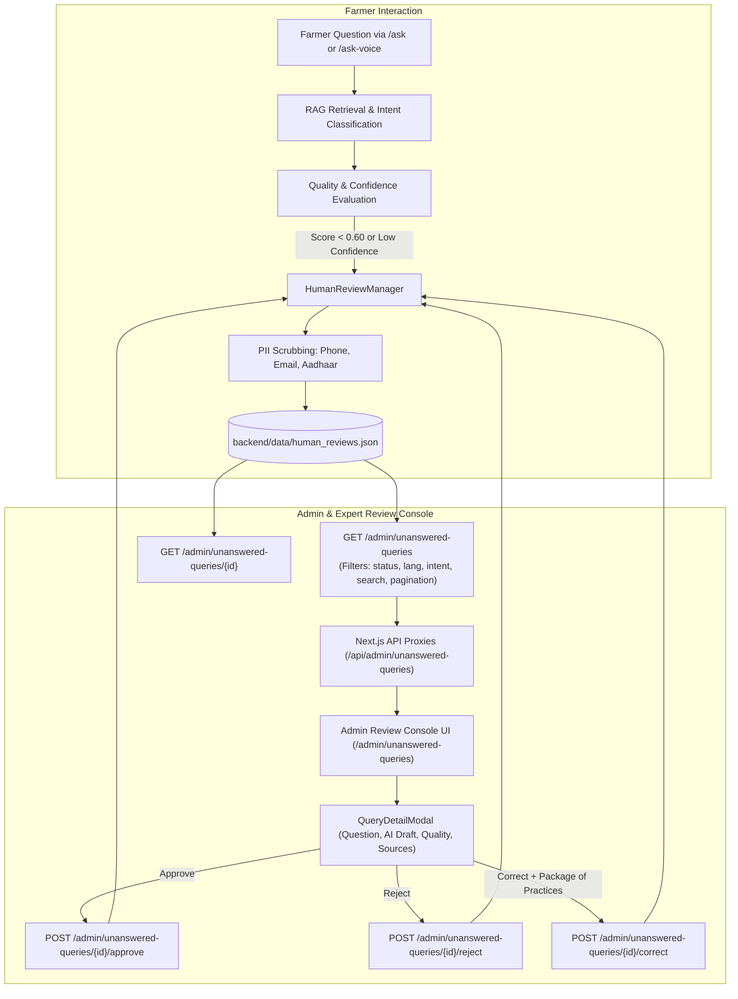

# FarmSaathi – Milestone 3, Part 4.2: Unanswered Query Management Report

**Date:** November 11, 2026  
**Status:** Completed & Fully Verified  
**Baseline Test Count:** 380 passed  
**New Test Count:** 394 passed (+14 tests)  
**Frontend Quality:** 0 ESLint errors/warnings, Next.js 16.4.5 Turbopack production build successful, 0 npm vulnerabilities  
**System Regression:** 22/22 Phase 3.5 integration checks passed  

---

## 1. Executive Summary

In **Milestone 3, Part 4.2**, we developed the **Unanswered Query Management & Review Console** for FarmSaathi. This subsystem empowers agricultural extension workers and agronomists to identify, inspect, verify, reject, or correct farmer questions that the autonomous RAG pipeline or knowledge repository could not answer with high confidence (e.g., retrieval confidence $< 0.60$, low quality score, or flagged queries).

All operations reuse the existing `HumanReviewManager` and `backend/data/human_reviews.json` repository without creating duplicate tables, schema conflicts, or redundant stores. Strict Role-Based Access Control (RBAC) ensures only users with `role="admin"` can access the review queue or perform review actions. Farmer-facing interfaces, voice pipelines, and session management remain untouched and fully regression-verified.

---

## 2. Architecture & Data Flow

---

## 3. Backend Implementation Details

### 3.1 Extended Review Storage Model & PII Redaction
In [`backend/review_manager.py`](backend/review_manager.py):
- Extended `ReviewRecord` dataclass with backward-compatible fields:
  - `language`: Detected language code (Hindi `hi`, Kannada `kn`, English `en`, etc.) with fallback script-heuristic detection for historical records.
  - `sources`: List of retrieved knowledge source citations.
  - `reviewer_username`: Audited username of the agricultural expert completing the review.
  - `reviewed_at`: ISO timestamp when status changed from `pending`.
  - `reviewer_notes`: Optional expert agronomic rationale.
  - `corrected_answer`: High-accuracy package of practices recommendation provided by the human reviewer.
- Retained and verified `sanitize_pii_for_review()` to strip 10-digit Indian mobile numbers, email addresses, and 12-digit Aadhaar numbers before persisting review records.

### 3.2 HumanReviewManager Capabilities
- **`list_queries()`**:
  - Multi-factor filtering: `status` (`pending`, `approved`, `rejected`, `corrected`, `all`), `language`, `intent`, `search` substring matching across questions and draft answers, `start_date`, and `end_date`.
  - Pagination: Configurable `limit` (1-100) and `offset`.
  - Summary Statistics: Returns real-time aggregate counts for `total`, `pending`, `approved`, `corrected`, and `rejected` queries.
- **`update_review()`**:
  - Handles status transitions to `approved`, `rejected`, `corrected`, or `pending`.
  - Strict validation: Requires a non-empty `corrected_answer` string when marking status as `corrected` (rejects whitespace with an error).
  - Persists atomic updates back to `backend/data/human_reviews.json`.

### 3.3 Admin Endpoints Registered in [`backend/main.py`](backend/main.py)
All endpoints enforce `admin_user: User = Depends(require_admin)`:
1. `GET /admin/unanswered-queries`: Filtered and paginated listing of queries with status counts.
2. `GET /admin/unanswered-queries/{query_id}`: Single query inspection, returning 404 for nonexistent IDs.
3. `PATCH /admin/unanswered-queries/{query_id}`: Partial update for status, reviewer notes, and corrected answer.
4. `POST /admin/unanswered-queries/{query_id}/approve`: Convenience action marking query as verified.
5. `POST /admin/unanswered-queries/{query_id}/reject`: Convenience action marking query guidance as rejected/unsafe.
6. `POST /admin/unanswered-queries/{query_id}/correct`: Convenience action submitting expert agricultural correction.

---

## 4. Frontend Implementation Details

### 4.1 Next.js API Route Proxies
Configured in the App Router to forward JWT authentication tokens and route traffic to the FastAPI backend:
- [`frontend/app/api/admin/unanswered-queries/route.ts`](frontend/app/api/admin/unanswered-queries/route.ts): Handles `GET` requests with query parameters for filtering and pagination.
- [`frontend/app/api/admin/unanswered-queries/[id]/route.ts`](frontend/app/api/admin/unanswered-queries/[id]/route.ts): Handles `GET` and `PATCH` requests for individual queries.
- [`frontend/app/api/admin/unanswered-queries/[id]/[action]/route.ts`](frontend/app/api/admin/unanswered-queries/[id]/[action]/route.ts): Handles `POST` action triggers (`approve`, `reject`, `correct`).

### 4.2 TypeScript Type Definitions
Added to [`frontend/app/admin/types.ts`](frontend/app/admin/types.ts):
- `ReviewRecordItem`: Typing for query text, canonical text, scores, flag reason, status, sources, and reviewer notes.
- `ReviewStats`: Aggregated count structure (`total`, `pending`, `approved`, `corrected`, `rejected`).
- `UnansweredQueriesResponse`: Full API response envelope with pagination controls.

### 4.3 Navigation & Admin Sidebar
Updated [`frontend/app/admin/components/AdminSidebar.tsx`](frontend/app/admin/components/AdminSidebar.tsx):
- Added dedicated navigation item for **Review Queue** (`/admin/unanswered-queries`) with active state indicator and amber alert badge.

### 4.4 Review Console Interface
Created [`frontend/app/admin/unanswered-queries/page.tsx`](frontend/app/admin/unanswered-queries/page.tsx):
- **Queue Status Cards**: 5 interactive metric cards (Total, Pending, Approved, Corrected, Rejected) allowing one-click queue filtering.
- **Search & Filter Controls**: Text search bar with debounce/submit, language selector (Hindi, Kannada, English, Tamil, Telugu), and agricultural intent selector (Pest Control, Irrigation, Crop Advisory, Market Prices, Government Schemes).
- **Responsive Review Table**: Displays Question preview, Intent badge, Language pill, Quality score bar, Flag reason, Status badge, Creation timestamp, and an "Inspect & Review" button.
- **Pagination Controls**: Previous/Next buttons with item range indicators (`Showing 1 to 15 of 130 queries`).

### 4.5 Query Inspection & Resolution Modal
Created [`frontend/app/admin/unanswered-queries/components/QueryDetailModal.tsx`](frontend/app/admin/unanswered-queries/components/QueryDetailModal.tsx):
- Shows the complete original farmer question and canonical translation.
- Displays quality metrics: Retrieval Confidence, Quality Score, Source Reliability, and Evidence Grounding.
- Displays AI draft answer (or low-confidence notification) and authoritative ICAR/Kisan Call Centre citations.
- Provides interactive input for **Expert Reviewer Notes** and a **Corrected Agricultural Answer** textarea.
- One-click action buttons: **Approve Guidance**, **Reject Guidance**, and **Save Correction & Close**.

---

## 5. Quality, Security & Verification

### 5.1 Automated Backend Tests
Created [`backend/test_admin_unanswered_queries.py`](backend/test_admin_unanswered_queries.py) with 14 automated tests:
1. `test_unauthenticated_requests_rejected`: Verifies 401 Unauthorized for listing, detail, and patch operations.
2. `test_farmer_role_forbidden`: Verifies 403 Forbidden when a farmer JWT attempts review endpoints.
3. `test_admin_list_queries_structure`: Validates response schema, stats breakdown, and pagination fields.
4. `test_filter_by_status`: Verifies status-isolated filtering (`status=pending`).
5. `test_filter_by_intent`: Verifies intent-based filtering (`intent=irrigation`).
6. `test_filter_by_language`: Verifies language-based filtering (`language=en`).
7. `test_search_filter`: Verifies keyword search across questions and answers.
8. `test_pagination`: Verifies limit and offset controls.
9. `test_get_query_detail_success_and_not_found`: Validates detail retrieval and 404 for invalid IDs.
10. `test_patch_review_status_approved`: Verifies status update to `approved` with notes and reviewer username.
11. `test_patch_review_status_rejected`: Verifies status update to `rejected`.
12. `test_patch_review_status_corrected_requires_answer`: Verifies 400 Bad Request if `corrected_answer` is blank; 200 OK when valid.
13. `test_action_convenience_endpoints`: Verifies `POST /approve`, `/reject`, and `/correct` convenience routes.
14. `test_pii_sanitization_for_reviews`: Confirms phone numbers, emails, and Aadhaar numbers are masked with `[REDACTED_*]`.

**Result:** 14 passed in 0.56s.

### 5.2 Full Backend Regression
Ran the entire backend test suite:
- **Baseline (Part 4.1):** 380 passed
- **Part 4.2 Total:** **394 passed**, 0 failed, 3 warnings in 51.17s

### 5.3 System Verification Harness (`verify_phase35.py`)
Executed the comprehensive system verification suite:
- **Result:** **22/22 checks passed (0 failed)**
  - Health probes, route catalog, session management, multi-turn pronoun resolution, RBAC security, voice mock safeguards, PWA assets, service worker caching rules, and frontend proxy contracts all verified green.

### 5.4 Frontend Code Quality & Build Checks
- **`npm run lint`:** Clean exit (0 errors, 0 warnings). React hooks dependencies and unescaped HTML entities resolved.
- **`npm run build`:** Production build compiled cleanly with Next.js 16.4.5 Turbopack. All static and dynamic routes optimized.
- **`npm audit`:** 0 vulnerabilities found.

---

## 6. Files Inspected, Modified, and Created

| File | Status | Purpose |
|---|---|---|
| `backend/review_manager.py` | Modified | Added multi-factor query listing, pagination, status transitions, and reviewer auditing |
| `backend/main.py` | Modified | Added 6 admin review endpoints with RBAC protection and request models |
| `backend/test_admin_unanswered_queries.py` | Created | 14 automated unit and integration tests for unanswered query management |
| `frontend/app/admin/types.ts` | Modified | Added TypeScript interfaces for review records and query stats |
| `frontend/app/admin/components/AdminSidebar.tsx` | Modified | Added navigation link and badge for Review Queue |
| `frontend/app/api/admin/unanswered-queries/route.ts` | Created | Next.js API route proxy for query listing and filtering |
| `frontend/app/api/admin/unanswered-queries/[id]/route.ts` | Created | Next.js API route proxy for query detail and patch updates |
| `frontend/app/api/admin/unanswered-queries/[id]/[action]/route.ts` | Created | Next.js API route proxy for approve, reject, and correct actions |
| `frontend/app/admin/unanswered-queries/page.tsx` | Created | Full responsive Admin Unanswered Queries and Review Queue console |
| `frontend/app/admin/unanswered-queries/components/QueryDetailModal.tsx` | Created | Modal dialog for agronomic inspection, validation, and correction |
| `MILESTONE3_PART4_2_UNANSWERED_QUERY_REPORT.md` | Created | Comprehensive verification report for Milestone 3, Part 4.2 |

---

## 7. Next Steps (Part 4.3 Preview)

As instructed, development has stopped at the boundary of Part 4.2 to await user review. The foundation is ready for **Part 4.3: Knowledge Base Management & Vector Re-indexing**:
1. Knowledge base document CRUD and upload endpoints.
2. Vector store re-indexing and synchronization with ChromaDB/NumPy store fallback.
3. Incorporating approved and corrected queries from the review queue back into the knowledge retrieval index.
