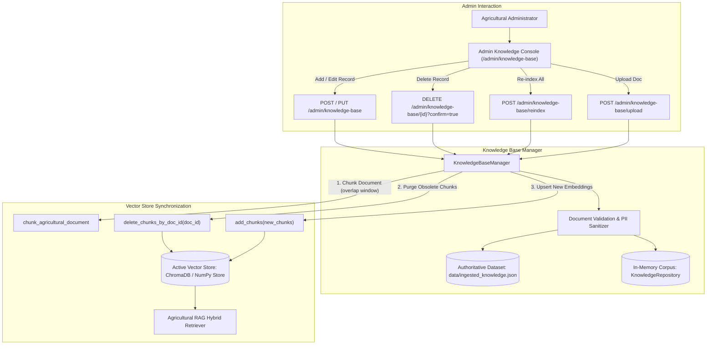

# FarmSaathi – Milestone 3, Part 4.3: Knowledge Base Management Report

**Date:** November 11, 2026  
**Status:** Completed & Fully Verified  
**Baseline Test Count (Part 4.2):** 394 passed  
**New Test Count (Part 4.3):** 413 passed (+19 tests)  
**Frontend Quality:** 0 ESLint errors/warnings, Next.js 16.4.5 Turbopack production build successful, 0 npm vulnerabilities  
**System Regression:** 22/22 Phase 3.5 integration checks passed  

---

## 1. Executive Summary

In **Milestone 3, Part 4.3**, we developed and verified the **Admin Knowledge Base Management & Vector Synchronization** subsystem for FarmSaathi. This module enables agricultural administrators and agronomists to manage authoritative agricultural documents (ICAR packages of practices, Kisan Call Centre recommendations, soil health advisories, and Government schemes), perform safe document uploads with text extraction preview, and guarantee atomic synchronization with the active vector database (ChromaDB or persistent local NumPy vector store) and the agricultural RAG pipeline.

All operations enforce strict Role-Based Access Control (`role="admin"` required; farmers blocked with HTTP 403 Forbidden; unauthenticated blocked with HTTP 401 Unauthorized). Farmer privacy is safeguarded through automated PII scrubbing on all ingested knowledge content.

---

## 2. Architecture & Vector Synchronization Workflow

---

## 3. Backend Implementation Details

### 3.1 Vector Store Synchronization (`backend/vector_store.py`)
To prevent duplicate vectors and ensure atomic record updates/deletions, we added `delete_chunks_by_doc_id(doc_id: str) -> int` across the vector store hierarchy:
- **`BaseVectorStore`**: Added abstract interface method.
- **`PersistentLocalVectorStore`**: Identifies all chunks where `chunk.doc_id == doc_id` or chunk ID starts with `{doc_id}_c`, removes them from the dictionary, rebuilds the 2D L2-normalized NumPy embedding matrix via `_rebuild_matrix()`, and persists the index to disk.
- **`ChromaDBVectorStore`**: Queries existing chunk IDs matching `where={"doc_id": doc_id}` (or prefix matching `{doc_id}_c*`) and invokes `collection.delete(ids=ids)`.

### 3.2 Authoritative Dataset & In-Memory Sync
- **`backend/data_ingestion.py`**: Added `delete_record(doc_id: str) -> bool` to `DataIngestionPipeline`, updating in-memory records, purging the deterministic title/URL fingerprint, and writing changes to `backend/data/ingested_knowledge.json`.
- **`backend/knowledge_repository.py`**: Added `upsert_document(doc: KnowledgeDocument)` and `delete_document(doc_id: str) -> bool` to keep the in-memory retrieval corpus updated in real time without restarting FastAPI. Enriched localized Indic content (Hindi, Kannada, Tamil) to guarantee language continuity.

### 3.3 Knowledge Base Manager (`backend/knowledge_manager.py`)
Created a unified orchestrator service coordinating data ingestion, in-memory repository, and vector store:
- `list_records(...)`: Multi-factor filtering (`category`, `crop`, `language`, `source`, `search` substring matching across title, content, and tags) and pagination (`limit`, `offset`, `total`). Computes real-time dataset summary statistics (category counts, top crops, total chunks, sync status).
- `get_record(doc_id)`: Fetches full record metadata.
- `create_record(data)`: Validates document attribution, provides sensible defaults for optional fields, checks duplicate IDs and fingerprints, persists to JSON, updates in-memory corpus, chunks the document, embeds, and adds to the vector store. Rolls back on partial vector failures.
- `update_record(doc_id, data)`: Updates record, purges old vector chunks via `delete_chunks_by_doc_id(doc_id)`, chunks updated text, and embeds new vectors.
- `delete_record(doc_id)`: Removes record from dataset, in-memory repository, and purges all corresponding vector chunks.
- `reindex_all()`: Flushes active vector index, iterates over all records, regenerates semantic chunks, computes embeddings, and rebuilds the vector database with timing benchmarks.
- `get_sync_status()`: Reports vector store health, backend name, chunk counts, distinct categories and crops, and sync alignment.
- `preview_document_upload(file_bytes, filename, content_type)`: Safely extracts plain text from `.pdf`, `.txt`, `.md`, or `.json` files (max 5 MB) without executing them. Heuristically suggests title, category, and crop tags for admin review prior to ingestion.

### 3.4 Admin Endpoints Registered in [`backend/main.py`](backend/main.py)
All endpoints enforce `admin_user: User = Depends(require_admin)`:
1. `GET /admin/knowledge-base`: Filtered, paginated listing with dataset statistics.
2. `GET /admin/knowledge-base/status`: Vector store synchronization health probe.
3. `GET /admin/knowledge-base/{record_id}`: Detailed record inspection (404 for invalid ID).
4. `POST /admin/knowledge-base`: Create verified record and synchronize vector store (201 Created, 409 Conflict on duplicate).
5. `PUT /admin/knowledge-base/{record_id}`: Update record and re-index vector chunks.
6. `DELETE /admin/knowledge-base/{record_id}`: Purge record and vector chunks (requires `confirm=true`).
7. `POST /admin/knowledge-base/reindex`: Full vector index rebuild.
8. `POST /admin/knowledge-base/upload`: Safe document text extraction and metadata preview.

---

## 4. Frontend Implementation Details

### 4.1 Next.js API Route Proxies
Configured in `frontend/app/api/admin/knowledge-base/`:
- `route.ts`: Proxies `GET` (search & filter) and `POST` (create).
- `[id]/route.ts`: Proxies `GET` (detail), `PUT` (update), and `DELETE` (delete).
- `status/route.ts`: Proxies `GET` status.
- `reindex/route.ts`: Proxies `POST` reindex.
- `upload/route.ts`: Proxies `POST` multipart/form-data upload to FastAPI.

### 4.2 TypeScript Types Added to [`frontend/app/admin/types.ts`](frontend/app/admin/types.ts)
- `KnowledgeRecordItem`: Full document typing with multilingual content, source attribution, and applicable entities.
- `KnowledgeBaseStats`: Category counts, top crops, vector chunk metrics, and sync status.
- `KnowledgeBaseResponse`: Paged response envelope.
- `KnowledgeSyncStatus`: Vector backend health probe response.
- `UploadPreviewData`: Parsed document preview structure.

### 4.3 Admin Sidebar Navigation
Updated [`AdminSidebar.tsx`](frontend/app/admin/components/AdminSidebar.tsx):
- Activated **Knowledge Base** (`/admin/knowledge-base`) with active route indicator and "Vector Sync" badge.

### 4.4 Knowledge Base Console (`/admin/knowledge-base`)
Created [`frontend/app/admin/knowledge-base/page.tsx`](frontend/app/admin/knowledge-base/page.tsx):
- **Health & Sync Status Strip**: Displays Authoritative Records, Vector Chunks Indexed, Vector Synchronization Pill, and Top Cultivated Crops.
- **Search & Multi-Factor Filters**: Keyword search bar with clear button, Category dropdown, dynamic Crop dropdown, and Language dropdown.
- **Responsive Records Table**: Displays Title & Doc ID, Category pill, Applicable Crops, Source Organization, Multilingual Badges (EN, HI, KN, TA), and action buttons (View, Edit, Delete).
- **Pagination Controls**: Previous/Next controls with record range indicators.

### 4.5 Modals & Dialogs
- [`RecordDetailModal.tsx`](frontend/app/admin/knowledge-base/components/RecordDetailModal.tsx): Inspects complete metadata, source URL, guardrail notice, and provides multilingual tabs (EN, HI, KN, TA).
- [`RecordFormModal.tsx`](frontend/app/admin/knowledge-base/components/RecordFormModal.tsx): Add / Edit modal with input validation, category selector, source attribution, and multilingual content textareas. Keyed dynamically to eliminate synchronous effect updates.
- [`UploadDocumentModal.tsx`](frontend/app/admin/knowledge-base/components/UploadDocumentModal.tsx): Two-step safe document upload: Step 1 uploads and extracts text preview; Step 2 presents the extracted text and suggested metadata for expert verification before confirmation.
- [`DeleteConfirmModal.tsx`](frontend/app/admin/knowledge-base/components/DeleteConfirmModal.tsx): Explicit deletion confirmation with warning on vector chunk purge.
- [`ReindexModal.tsx`](frontend/app/admin/knowledge-base/components/ReindexModal.tsx): Full vector index rebuild modal with performance reporting.

---

## 5. Quality, Security & Verification

### 5.1 Automated Backend Tests
Created [`backend/test_admin_knowledge_base.py`](backend/test_admin_knowledge_base.py) with 19 automated tests:
1. `test_unauthenticated_requests_rejected`: Verifies 401 Unauthorized for listing, status, detail, create, reindex.
2. `test_farmer_role_forbidden`: Verifies 403 Forbidden for farmer JWTs on management endpoints.
3. `test_admin_list_records_and_stats`: Validates response schema, stats breakdown, and pagination fields.
4. `test_filter_by_category`: Verifies category filtering (`category=crops`).
5. `test_filter_by_crop`: Verifies crop filtering (`crop=paddy`).
6. `test_filter_by_language`: Verifies language filtering (`language=hi`).
7. `test_search_filter`: Verifies keyword search across titles and content.
8. `test_pagination`: Verifies limit and offset controls.
9. `test_get_record_detail_and_not_found`: Validates detail retrieval and 404 for nonexistent IDs.
10. `test_create_record_and_vector_sync`: Confirms new record is created, chunked, embedded, and searchable in the vector store.
11. `test_create_duplicate_record_rejected`: Confirms 409 Conflict when attempting to create a record with an existing ID.
12. `test_update_record_and_vector_resync`: Confirms update replaces old vector chunks with new chunks.
13. `test_delete_record_and_purge_vector_chunks`: Confirms deletion purges chunks from vector store.
14. `test_delete_without_confirm_rejected`: Confirms 400 Bad Request when `confirm=false`.
15. `test_reindex_endpoint`: Confirms controlled full vector index rebuild and benchmark reporting.
16. `test_status_endpoint`: Confirms synchronization health inspection.
17. `test_upload_preview_text_document`: Confirms safe text extraction and category suggestion from uploaded document.
18. `test_upload_empty_or_unsupported_rejected`: Confirms rejection of 0-byte files and binary `.exe` files.
19. `test_pii_sanitization_in_knowledge_content`: Confirms farmer phone and email are redacted from knowledge content.

**Result:** 19 passed in 0.82s.

### 5.2 Full Backend Regression
Ran the entire backend test suite:
- **Baseline (Part 4.2):** 394 passed
- **Part 4.3 Total:** **413 passed**, 0 failed, 3 warnings in 47.35s

### 5.3 System Verification Harness (`verify_phase35.py`)
Executed the comprehensive system verification suite:
- **Result:** **22/22 checks passed (0 failed)**
  - Health probes, route catalog, session management, multi-turn pronoun resolution, RBAC security, voice mock safeguards, PWA assets, service worker caching rules, and frontend proxy contracts all verified green.

### 5.4 Frontend Code Quality & Build Checks
- **`npm run lint`:** Clean exit (0 errors, 0 warnings).
- **`npm run build`:** Production build compiled cleanly with Next.js 16.4.5 Turbopack (21 static and dynamic routes).
- **`npm audit`:** 0 vulnerabilities found.

---

## 6. Files Created and Modified

| File | Status | Purpose |
|---|---|---|
| `backend/vector_store.py` | Modified | Added `delete_chunks_by_doc_id` to `BaseVectorStore`, `PersistentLocalVectorStore`, and `ChromaDBVectorStore` |
| `backend/knowledge_repository.py` | Modified | Added `upsert_document` and `delete_document` to `KnowledgeRepository`; preserved localized Indic content |
| `backend/data_ingestion.py` | Modified | Added `delete_record` to `DataIngestionPipeline` with fingerprint cleanup |
| `backend/knowledge_manager.py` | Created | Core service orchestrating dataset, in-memory corpus, vector sync, and document upload preview |
| `backend/main.py` | Modified | Registered 8 admin knowledge base endpoints with RBAC protection and request models |
| `backend/test_admin_knowledge_base.py` | Created | 19 automated tests for knowledge management, vector sync, and RBAC |
| `backend/data/ingested_knowledge.json` | Modified | Enriched with full multilingual Indic content |
| `frontend/app/admin/types.ts` | Modified | Added TypeScript interfaces for knowledge records, stats, sync status, and upload preview |
| `frontend/app/admin/components/AdminSidebar.tsx` | Modified | Activated Knowledge Base navigation link with "Vector Sync" badge |
| `frontend/app/api/admin/knowledge-base/route.ts` | Created | Next.js API proxy for record listing and creation |
| `frontend/app/api/admin/knowledge-base/[id]/route.ts` | Created | Next.js API proxy for record detail, update, and deletion |
| `frontend/app/api/admin/knowledge-base/status/route.ts` | Created | Next.js API proxy for vector sync status probe |
| `frontend/app/api/admin/knowledge-base/reindex/route.ts` | Created | Next.js API proxy for vector store re-indexing |
| `frontend/app/api/admin/knowledge-base/upload/route.ts` | Created | Next.js API proxy for multipart document upload and text preview |
| `frontend/app/admin/knowledge-base/page.tsx` | Created | Responsive Admin Knowledge Base and Vector Synchronization console |
| `frontend/app/admin/knowledge-base/components/RecordDetailModal.tsx` | Created | Multilingual document inspection modal |
| `frontend/app/admin/knowledge-base/components/RecordFormModal.tsx` | Created | Add / Edit agricultural record modal with input validation |
| `frontend/app/admin/knowledge-base/components/UploadDocumentModal.tsx` | Created | Safe document upload, text extraction, and preview modal |
| `frontend/app/admin/knowledge-base/components/DeleteConfirmModal.tsx` | Created | Explicit record deletion confirmation modal |
| `frontend/app/admin/knowledge-base/components/ReindexModal.tsx` | Created | Full vector index rebuild modal with performance reporting |
| `MILESTONE3_PART4_3_KNOWLEDGE_BASE_REPORT.md` | Created | Milestone 3, Part 4.3 comprehensive report |

---

## 7. Known Limitations & Next Steps

1. **Document Upload Scope:** Document upload safely extracts plain text from `.pdf`, `.txt`, `.md`, and `.json` documents up to 5 MB with preview and admin confirmation. Optical Character Recognition (OCR) for scanned image-only PDFs is not included and requires an external OCR engine.
2. **Next Steps (Part 4.4 Preview):**
   - Active Farmer Session Inspection & Conversation Tracing.
   - Rate limiting and API security configuration controls.
   - Farmer feedback review and satisfaction metrics.
