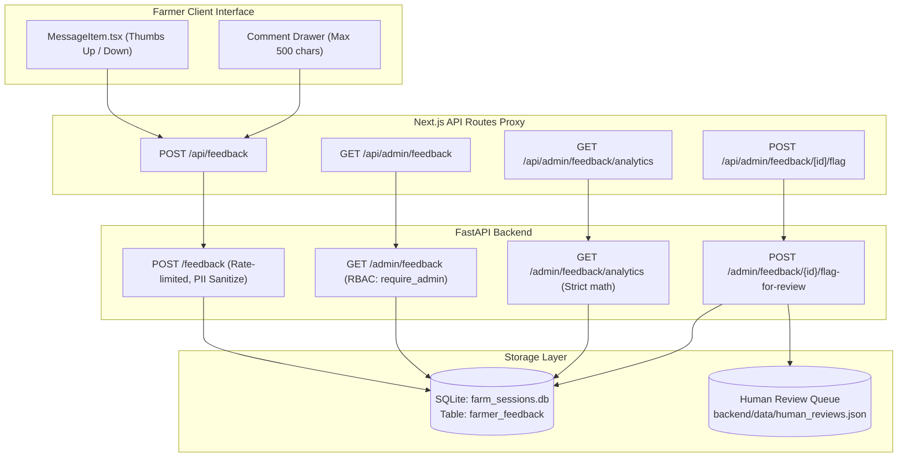

# FarmSaathi – Milestone 3, Part 4.4 Report
## Farmer Feedback Management & Satisfaction Analytics

**Status:** Completed & Fully Verified  
**Date:** 2026-11-11  
**Project:** FarmSaathi – AI-Driven Smart Farming Assistant  
**Milestone:** Milestone 3, Part 4.4: Farmer Feedback & Satisfaction Monitoring  

---

## 1. Executive Summary

Milestone 3, Part 4.4 implements an end-to-end **Farmer Feedback and Satisfaction Analytics** system connecting the multilingual farmer conversational interface directly with the administrative monitoring console and the expert human review pipeline.

### Key Capabilities Delivered:
1. **Interactive Farmer Feedback UI**:
   - Integrated thumbs-up (👍) and thumbs-down (👎) action controls within the conversational assistant responses (`MessageItem.tsx`).
   - Expandable comment drawer for dissatisfied farmers with a 500-character counter and automatic PII scrub warning.
   - Trilingual localizations in English, Hindi (हिंदी), and Kannada (ಕನ್ನಡ) in `translations.ts`.
   - Client-side deduplication and local persistence across page reloads via `localStorage`.

2. **Persistent Relational Feedback Storage & Privacy Guardrails**:
   - Created the `farmer_feedback` relational table in SQLite (`farm_sessions.db`) bound by foreign key cascades to `farmer_sessions`.
   - Structured indexing across `session_id`, `rating`, `created_at`, and a unique constraint on `message_id`.
   - Automatic sanitization of emails, 10-digit Indian phone numbers, and 12-digit Aadhaar IDs using `sanitize_pii_for_review()`.
   - Session ownership validation via `verify_session_access()` ensuring anonymous sessions are supported while preventing cross-farmer tampering.

3. **Admin Feedback & Satisfaction Console (`/admin/feedback`)**:
   - High-level KPI metric cards: **Overall Farmer Satisfaction (%)**, **Total Ratings**, **Positive Feedback Count (👍)**, and **Negative Feedback Count (👎)**.
   - Comprehensive Analytics visualizations:
     - **Daily Trends**: Comparative timeline displaying positive vs. negative volume and satisfaction rate per day.
     - **Satisfaction by Language**: Breakdown across English, Hindi, Kannada, Tamil, etc.
     - **Satisfaction by Intent**: Granular performance tracking across Crop Advisory, Pest Control, Irrigation, Mandi Prices, and Government Schemes.
   - Filter bar with instant filtering by rating, language, intent, and keyword search across query text, answers, and farmer comments.
   - Detailed inspection modal (`FeedbackDetailModal.tsx`) with **one-click flagging** into the Agricultural Expert Review queue.

---

## 2. Architecture & Data Schema



### Database Schema: `farmer_feedback`
```sql
CREATE TABLE IF NOT EXISTS farmer_feedback (
    feedback_id TEXT PRIMARY KEY,
    session_id TEXT NOT NULL,
    message_id TEXT NOT NULL UNIQUE,
    rating TEXT NOT NULL CHECK(rating IN ('positive', 'negative')),
    comment TEXT,
    farmer_id TEXT,
    language TEXT NOT NULL DEFAULT 'en',
    intent TEXT,
    query_text TEXT,
    answer_text TEXT,
    review_id TEXT,
    created_at TEXT NOT NULL,
    updated_at TEXT NOT NULL,
    FOREIGN KEY (session_id) REFERENCES farmer_sessions(session_id) ON DELETE CASCADE
);

CREATE INDEX IF NOT EXISTS idx_feedback_session ON farmer_feedback(session_id);
CREATE INDEX IF NOT EXISTS idx_feedback_rating ON farmer_feedback(rating);
CREATE INDEX IF NOT EXISTS idx_feedback_created ON farmer_feedback(created_at);
CREATE INDEX IF NOT EXISTS idx_feedback_message ON farmer_feedback(message_id);
```

### Satisfaction Rate Formula:
$$\text{Satisfaction Rate} = \begin{cases} \text{round}\left(\frac{\text{Positive Ratings}}{\text{Total Valid Ratings}} \times 100, 1\right) & \text{if Total Valid Ratings} > 0 \\ 0.0 & \text{if Total Valid Ratings} = 0 \end{cases}$$

---

## 3. Implementation Details

### 3.1 Backend Components Modified/Created:
- `backend/session_manager.py`:
  - Updated `record_turn()` to return `(user_msg, assistant_msg)` containing `message_id`.
  - Added `record_feedback()`, `get_feedback()`, `get_feedback_by_message_id()`, `get_feedback_detail()`, `list_feedback()`, `get_feedback_analytics()`, and `flag_feedback_for_review()`.
  - Updated `get_analytics_summary()` to aggregate live counts from `farmer_feedback`.
  - Updated `clear_all()` to purge `farmer_feedback`.
- `backend/main.py`:
  - Surfaced `message_id` on responses for `/ask`, `/ask-voice-json`, and `/ask-voice`.
  - Implemented `POST /feedback` (rate-limited, session validation, ownership check).
  - Implemented `GET /admin/feedback` (filtered & paginated list).
  - Implemented `GET /admin/feedback/analytics` (satisfaction rate, trends, breakdowns).
  - Implemented `GET /admin/feedback/{feedback_id}` (detailed inspection).
  - Implemented `POST /admin/feedback/{feedback_id}/flag-for-review` (one-click queueing).
- `backend/test_admin_feedback.py`:
  - 12 comprehensive automated tests covering all submission paths, security boundaries, PII scrub, deduplication, filters, and analytics calculations.

### 3.2 Frontend Components Modified/Created:
- `frontend/app/types.ts`:
  - Added `message_id` to `ApiResponse`.
  - Added `messageId`, `sessionId`, `feedbackRating`, and `feedbackComment` to `ChatMessage`.
- `frontend/app/admin/types.ts`:
  - Added `FarmerFeedbackItem`, `FeedbackSummaryStats`, `FeedbackListResponse`, `FeedbackDailyTrendPoint`, `FeedbackLanguageMetric`, `FeedbackIntentMetric`, and `FeedbackAnalyticsResponse`.
- `frontend/app/lib/translations.ts`:
  - Added trilingual localized strings (`helpful`, `notHelpful`, `feedbackPrompt`, `feedbackThanks`, `feedbackCommentPlaceholder`, `feedbackSubmit`).
- `frontend/app/components/MessageItem.tsx`:
  - Implemented thumbs-up and thumbs-down interaction, comment drawer, PII alert, and local deduplication.
- `frontend/app/page.tsx`:
  - Attached persistent `messageId` and `sessionId` to `ChatMessage` objects in text and voice handlers.
  - Linked `onFeedbackSubmitted` callback to update in-memory and local storage state.
- `frontend/app/admin/components/AdminSidebar.tsx`:
  - Added "Feedback & Satisfaction" navigation entry with custom icon.
- `frontend/app/admin/feedback/page.tsx`:
  - Complete feedback console with metric cards, daily trend charts, language & intent breakdowns, filtering, search, paginated table, and detail modal.
- `frontend/app/admin/feedback/components/FeedbackDetailModal.tsx`:
  - Inspection modal displaying query, answer, comment, masked farmer ID, and one-click flagging into the expert review queue.
- API Proxies:
  - `frontend/app/api/feedback/route.ts`
  - `frontend/app/api/admin/feedback/route.ts`
  - `frontend/app/api/admin/feedback/analytics/route.ts`
  - `frontend/app/api/admin/feedback/[id]/route.ts`
  - `frontend/app/api/admin/feedback/[id]/flag/route.ts`

---

## 4. Verification and Test Results

### 4.1 Automated Backend Test Suite
```
pytest -q
425 passed, 3 warnings in 75.33s
```
*Note: Includes all 413 baseline tests + 12 newly developed feedback tests in `test_admin_feedback.py`.*

| Test File | Status | Description |
| :--- | :---: | :--- |
| `test_admin_feedback.py` | **12 / 12 PASS** | Feedback submission, PII sanitization, duplicate updates, RBAC, analytics, flagging |
| `test_admin_analytics.py` | **6 / 6 PASS** | Admin analytics summary integration & real feedback counts |
| `test_admin_knowledge_base.py` | **19 / 19 PASS** | Knowledge base CRUD, vector sync, re-indexing |
| `test_admin_unanswered_queries.py`| **14 / 14 PASS** | Human review queue, approval, correction, rejection |
| `test_security.py` | **53 / 53 PASS** | Input validation, rate limiting, JWT, password hashing, RBAC |
| All other backend suites | **321 / 321 PASS** | Session resolution, RAG, adapters, translation, voice |

### 4.2 Phase 3.5 System Verification Harness
```
python verify_phase35.py
======================================================================
PHASE 3.5 RESULTS: 22/22 CHECKS PASSED (0 FAILED)
======================================================================
```

### 4.3 Frontend Verification
- **ESLint**:
  ```
  npm run lint
  > eslint
  (0 errors, 0 warnings)
  ```
- **Next.js Production Build**:
  ```
  npm run build
  ▲ Next.js 16.4.5 (Turbopack)
  ✓ Compiled successfully
  ✓ Generating static pages (25/25)
  ```
- **Security Audit**:
  ```
  npm audit
  found 0 vulnerabilities
  ```

---

## 5. Next Steps
Milestone 3, Part 4.4 is complete, verified, and ready for user review. Development is stopped here per instructions. Proceed to **Part 4.5** upon user instruction.
