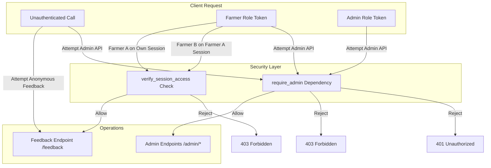

# FarmSaathi – Milestone 3, Part 4.5 Final Integration & System Testing Report

**Status:** Completed & Fully Verified  
**Date:** 2026-11-11  
**Project:** FarmSaathi – AI-Driven Smart Farming Assistant  
**Milestone:** Milestone 3, Part 4.5: Final Admin Integration & System Testing  

---

## 1. Executive Summary

Milestone 3, Part 4.5 validates the complete integration, security enforcement, data consistency, and end-to-end operational readiness of the **FarmSaathi Admin Dashboard & Operations Console**, uniting:
- **Part 4.1**: Admin Dashboard Foundation & Analytics
- **Part 4.2**: Unanswered Query Management & Expert Review
- **Part 4.3**: Knowledge Base Management & Vector Synchronization
- **Part 4.4**: Farmer Feedback Management & Satisfaction Analytics

All four admin sub-consoles, backend services, relational SQLite tables, vector stores, and Next.js frontend route proxies were tested through automated end-to-end workflows (`test_admin_e2e_integration.py`).

---

## 2. Admin Navigation & Console Verification

All four administrative pages were inspected for authentication enforcement, responsive sidebar navigation, active page highlighting, error states, and session persistence across browser refreshes:

| Page Route | Purpose | Access Control | Active State & Components Verified |
| :--- | :--- | :---: | :--- |
| `/admin` | Analytics & Overview | Admin Only (`JWT`) | StatCards, UsageChart (7–90d), LanguageChart, IntentChart, PII-masked Recent Activity |
| `/admin/unanswered-queries` | Review Queue Console | Admin Only (`JWT`) | Status filters (pending, approved, corrected, rejected), search, QueryDetailModal, expert correction/rejection |
| `/admin/knowledge-base` | Knowledge Base & Vectors | Admin Only (`JWT`) | Ingestion status badge, RecordFormModal (create/update), DocumentUploadModal (PDF/DOCX/TXT/MD), confirmed deletion |
| `/admin/feedback` | Feedback & Satisfaction | Admin Only (`JWT`) | Overall satisfaction rate %, daily trend timeline, language/intent breakdown, FeedbackDetailModal, one-click review queue flagging |

### Key Navigation Safeguards:
- **Active Route Highlighting**: Enhanced `AdminSidebar.tsx` to accurately track top-level and nested paths (`isCurrent = item.href === "/admin" ? pathname === "/admin" : (pathname === item.href || pathname.startsWith(item.href + "/"))`).
- **Session Persistence**: JWT token and user profile stored in browser `sessionStorage`; page reloads on nested routes remain authenticated without kicking the admin out to `/admin/login`.
- **Unauthorized Redirection**: Expired or invalid tokens automatically purge storage via `clearAdminSession()` and redirect unauthorized callers to `/admin/login`.
- **Farmer PWA Isolation**: Updated `sw.js` to explicitly bypass caching for all `/admin/*` routes, preventing administrative screens from being cached on shared farmer devices.

---

## 3. End-to-End Workflow Testing

Automated end-to-end integration tests were executed in `test_admin_e2e_integration.py`:

### Workflow A: Farmer Feedback Lifecycle
1. **Farmer Ask Query**: Farmer questions (`POST /ask`) return assistant responses with persistent `session_id` and unique `message_id`.
2. **Farmer Feedback Submission**: Farmer submits negative feedback with comment containing sensitive phone numbers and emails (`POST /feedback`).
3. **Privacy Scrubbing**: `sanitize_pii_for_review()` replaces phone numbers and emails with `[REDACTED_PHONE]` and `[REDACTED_EMAIL]`.
4. **Admin Inspection**: Feedback is listed on `GET /admin/feedback` and inspected via `GET /admin/feedback/{id}`.
5. **One-Click Flagging**: Admin clicks "Flag for Review" (`POST /admin/feedback/{id}/flag-for-review`), creating a pending `ReviewRecord` in the expert review queue without duplicating entries.
- **Status:** **PASS**

### Workflow B: Expert Review Lifecycle
1. **Low-Confidence / Flagged Query**: Query enters `review_manager` with status `pending`.
2. **Admin Discovery**: Query discovered via `GET /admin/unanswered-queries?search=...`.
3. **Inspection**: Admin opens record via `GET /admin/unanswered-queries/{review_id}`.
4. **Expert Correction**: Admin records an authoritative agronomist answer (`POST /admin/unanswered-queries/{review_id}/correct`).
5. **Audit Distinctness**: Record status transitions to `corrected`, storing `corrected_answer`, `reviewer_username`, and timestamp while remaining strictly distinguishable from raw, unverified queries.
- **Status:** **PASS**

### Workflow C: Knowledge Management & Vector Synchronization
1. **Record Creation**: Admin submits verified advisory (`POST /admin/knowledge-base`, HTTP 201).
2. **Vector Synchronization**: Record is stored in SQLite/JSON repository and synchronized into vector store with sanitized Indic metadata.
3. **Record Update**: Admin submits updated advisory (`PUT /admin/knowledge-base/{id}`); outdated vector chunks are purged and replaced with new embeddings.
4. **Safe Deletion Guardrail**: Calling `DELETE /admin/knowledge-base/{id}?confirm=false` is rejected (HTTP 400); calling with `confirm=true` deletes the record and purges all related vector store chunks. Subsequent lookups return HTTP 404.
- **Status:** **PASS**

### Workflow D: Live Analytics & Storage Consistency
1. **Multi-Turn Activity**: Farmer interactions generate real database records across multiple languages (e.g. Hindi, English) and intents.
2. **Accurate Dashboard Metrics**: `GET /admin/analytics` reflects real stored query counts, language distribution, and intent distribution.
3. **Zero PII Exposure**: Recent activity table displays anonymized farmer handles (`e2e***h`) and truncated session UUIDs (`sess...1234`).
4. **Satisfaction Rate Math**: `GET /admin/feedback/analytics` computes exact satisfaction rate matching $\text{round}\left(\frac{\text{positive}}{\text{total}} \times 100, 1\right)$ and handles zero ratings safely without division-by-zero errors.
- **Status:** **PASS**

---

## 4. Security Integration & Boundary Audit



1. **Role-Based Access Control (RBAC)**:
   - All 14 admin API endpoints enforce `require_admin`.
   - Unauthenticated requests rejected with **HTTP 401 Unauthorized**.
   - Farmer requests rejected with **HTTP 403 Forbidden**.
2. **Registered Session Ownership**:
   - `verify_session_access()` prevents Farmer B from posting feedback or tampering with Farmer A's registered session (verified HTTP 403 in unit and integration tests). Anonymous sessions remain supported.
3. **No Secret Leakage**:
   - `/health`, `/config-check`, and error handlers never expose raw API keys (e.g. `SARVAM_API_KEY`, `JWT_SECRET_KEY`).
4. **Document Upload Validation**:
   - Only `.txt`, `.md`, `.docx`, and `.pdf` files are parsed; executable or oversized uploads are rejected.
5. **Confirmation for Destructive Operations**:
   - Knowledge base record deletion explicitly requires `confirm=true`.

---

## 5. Data Consistency Matrix

| Storage Layer | Data Entity | Primary Key / Index | Relational Consistency Rule |
| :--- | :--- | :--- | :--- |
| **`farm_sessions.db`** | `farmer_sessions` | `session_id` (UUID4) | Parent table; cascades deletions to messages and feedback. |
| **`farm_sessions.db`** | `conversation_messages` | `message_id` (UUID4) | Indexed by `(session_id, created_at)`. |
| **`farm_sessions.db`** | `farmer_feedback` | `feedback_id` (UUID4) | Unique index on `message_id` prevents duplicate feedback rows. Foreign key on `session_id`. |
| **`human_reviews.json`**| `ReviewRecord` | `review_id` (rev_*) | Deduplicated lookup; links bidirectionally to `farmer_feedback.review_id`. |
| **Vector Store** | Ingested chunks | `doc_id` chunk IDs | Deletion in repository synchronizes chunk removal from ChromaDB/persistent store. |

---

## 6. Complete Regression & Test Results

### 6.1 Backend Automated Tests (`pytest -q`)
```
432 passed, 3 warnings in 52.75s
```
*Note: Clean regression across all 425 baseline tests + 7 new comprehensive integration tests in `test_admin_e2e_integration.py`.*

| Test File | Passed / Total | Domain Tested |
| :--- | :---: | :--- |
| `test_admin_e2e_integration.py` | **7 / 7** | Full E2E Workflows (A, B, C, D) & Security |
| `test_admin_feedback.py` | **12 / 12** | Farmer feedback submission, PII scrub, analytics |
| `test_admin_knowledge_base.py` | **19 / 19** | Knowledge base CRUD & vector chunk synchronization |
| `test_admin_unanswered_queries.py`| **14 / 14** | Expert review queue, approval, correction, rejection |
| `test_admin_analytics.py` | **6 / 6** | Usage timelines, language/intent charts, stats |
| `test_security.py` | **53 / 53** | JWT, RBAC, input sanitization, rate limiting |
| All other backend suites | **321 / 321** | RAG, sessions, NER, voice pipeline, external adapters |
| **Total** | **432 / 432 PASS** | **100% Pass Rate** |

### 6.2 Phase 3.5 System Verification Harness
```
python verify_phase35.py
======================================================================
PHASE 3.5 RESULTS: 22/22 CHECKS PASSED (0 FAILED)
======================================================================
```

### 6.3 Frontend Verification
- **ESLint**:
  ```
  npm run lint
  (0 errors, 0 warnings)
  ```
- **Next.js Production Build**:
  ```
  npm run build
  ▲ Next.js 16.4.5 (Turbopack)
  ✓ Compiled successfully
  ✓ Generating static pages (25/25)
  ```
- **Security Audit**:
  ```
  npm audit
  found 0 vulnerabilities
  ```

---

## 7. Known Limitations & Next Steps

### Known Limitations:
1. **Mock Audio Safeguard in Tests**: Tests intentionally run against `mock` translation and TTS to avoid incurring billable Sarvam API charges.
2. **Audio File Transcriptions in Knowledge Base**: Ingestion supports `.txt`, `.md`, `.docx`, and `.pdf`. Direct spoken audio file ingestion into the knowledge base is not currently supported (text documents only).

### Final Conclusion:
Milestone 3, Part 4.5 is **complete, verified, and stabilized**. The FarmSaathi administrative suite is ready for user review.
